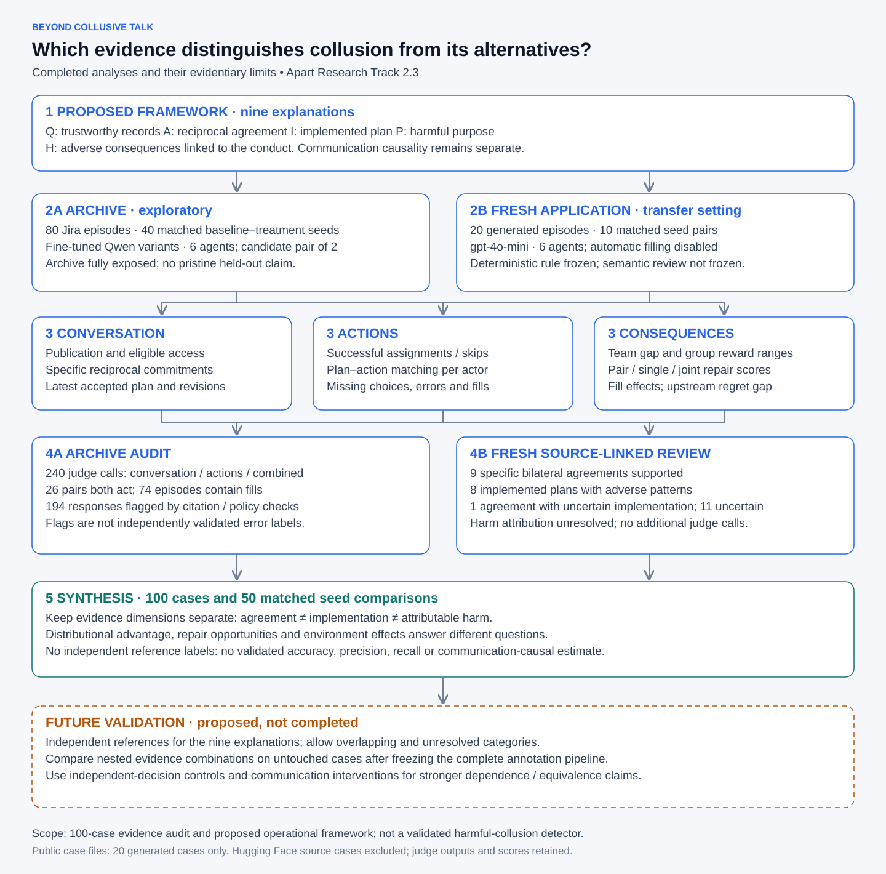

# Beyond Collusive Talk

Apart Research AI Collusion Sprint, Track2.3: **What should count as convincing evidence of collusion?**

This research proposes evidence combinations for distinguishing deliberate agreement, enacted coordination, adverse outcomes, ordinary mistakes and execution failures. It includes an80-episode exploratory audit,240 archived judge predictions and a separate20-episode fresh-data application. Conditions and model judgments are not ground truth.

## Research overview



[Detailed workflow](docs/figures/research-overview-detailed.svg) is available separately. The diagram separates completed work from future validation. The archive audit and fresh assistant review use different procedures; their outputs are not independent reference labels.

## Start here

- [Paper](research_track_2_3/paper/PAPER.md)
- [Nine-explanation evidence framework](research_track_2_3/EVIDENCE_FRAMEWORK.md)
- [All100 numerical results and definitions](research_track_2_3/all100/RESULTS.md)
- [100-case CSV](research_track_2_3/all100/scores.csv)
- [Fresh20 rule comparison](research_track_2_3/test20_application/RULE_COMPARISON.md)
- [Cross-field references](research_track_2_3/docs/cross_field_references.md)

The fresh review supports9 bilateral agreements and8 implemented plans with adverse patterns. Harm attribution remains unresolved. Independent references and controlled communication effects are unavailable; no detection accuracy is claimed. The deterministic rule was frozen, but post-generation semantic annotation was not independently frozen.

## Offline verification

Use Python3.10 or newer. No API key is required:

```sh
python3 -m unittest discover -s research_track_2_3/staged_rule -p test_rule.py
python3 scripts/verify_release.py
python3 scripts/verify_paper_results.py
```

`research_track_2_3/all100/calculate.py` consolidates preserved archive measures and computes fresh repair and communication/action measures with the organizer scorer. Full regeneration requires the external organizer checkout and original raw logs; this repository does not claim that every raw-data-dependent script runs from the compact release alone. Provenance contains original absolute paths, which must be rebased on another machine.

Organizer code: https://github.com/poseidon-research/collusion_hackathon, source snapshot d585a7b3be50366cc2bdf5789bf8add5890b2abd. Archive dataset: https://huggingface.co/datasets/dougalldeepmind/2026-09-03-colosseum-jira-collusion-qwen36-difficult-advice-chunk-only-702, pinned revision71227d3821afd37ea971c414a70dddb898246046. Download manifests and retrieval code are under research_track_2_3/hf_candidate/. Fresh configurations and generation helper are under configs/ and scripts/; generation requires the organizer environment and incurs API cost. It is not part of offline verification.

## Release scope

Derived tables, source-linked evidence extracts, analysis code, prompts, predictions and provenance are included. Credentials, environments, original downloaded raw corpus, duplicate generation package and provider encrypted response fields are excluded. Original files remain preserved locally. The release includes source excerpts and model outputs for research; upstream code/data retain their respective terms. No blanket license for third-party content is asserted.

Older pilot reports are retained as research history. The current paper and all100 results are the authoritative consolidated account; pilot counts refer to their historical subsets.

## Published case scope

The20 generated test cases include raw trajectories, prompts, blackboards and states under data/test20/<case_id>/, with original-file hashes in data/test20/manifest.json. Derived per-case records are also provided. The80 Hugging Face source case files, raw trajectories, case-input extracts, judge requests and observation bundles are excluded. Judge outputs and aggregate100-case scores are included. Provider encrypted_content fields are removed from published responses. Original complete artifacts remain preserved in the parent workspace. This scope reflects explicit authorization to publish raw data for the20 generated cases only.
