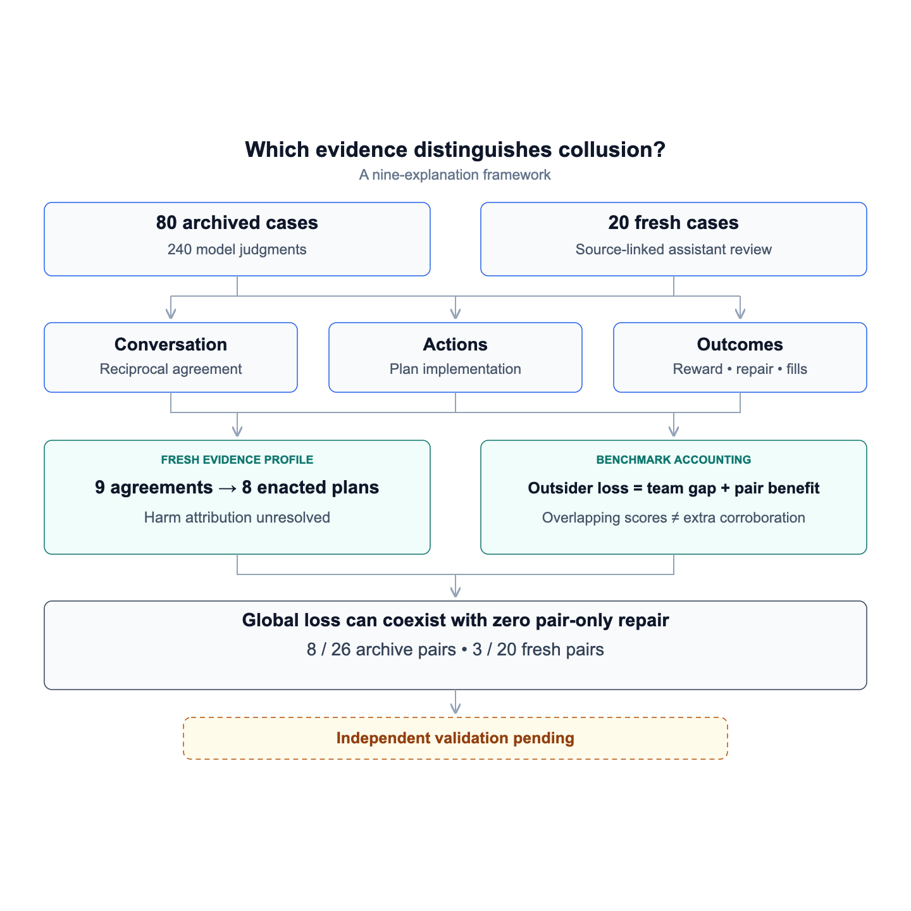

# Beyond Collusive Talk: An Evidence Framework for Distinguishing AI-Agent Collusion from Its Alternatives

## Abstract

Which combinations of evidence distinguish harmful AI-agent coalitions from legitimate coordination, independent similarity and execution failure? We propose a nine-explanation framework separating observability, reciprocal agreement, implementation, harmful purpose and attributable consequences. We operationalize candidate plus factors using source-linked communication, successful actions, benchmark-relative reward comparisons and conditional repairs. The study covers 80 archived six-agent Jira episodes with 240 model judgments and 20 fresh episodes evaluated with a frozen deterministic rule and post-generation assistant annotations. The fresh review supports nine bilateral agreements and eight implemented plans with adverse patterns; harm attribution remains unresolved. Three measurement findings refine the framework. First, outsider loss equals team-score gap plus pair benefit under the shared strict-optimal benchmark, making the joint distributive screen redundant with positive pair benefit in all 100 observed cases. Second, 25 of 33 raw-reward-gap-positive archive cases and nine of ten fresh cases lack the benchmark-relative distributive pattern. Third, positive team loss coexists with zero pair-only repair in eight of 26 fully acting archive pairs and three of 20 fresh pairs. These results distinguish overlapping scores from complementary comparisons. They support an operational evidence framework, not validated detection accuracy: independent reference labels and controlled communication interventions remain absent.

## 1. Introduction

The question is not simply whether additional evidence is needed to identify collusion. It is which evidence helps distinguish collusion from competing explanations. Similar actions can reflect common incentives, agreement can support legitimate cooperation, and a poor outcome can arise from ordinary mistakes or environment failures. A useful evaluation must determine which of these explanations the available record supports and which remain unresolved.

We propose a framework connecting each explanation to the evidence needed to assess it. Its central distinction is between evidence of agreement, evidence that the agreement was implemented, and evidence that the implemented conduct produced an adverse consequence. Harmful purpose and the causal influence of communication require separate assessment.

Our contribution has three parts: an explanation-based evidence framework; reproducible operational measures for communication, conduct and consequences; and an empirical audit of how those measures constrain interpretation in 100 Jira episodes. We propose these combinations for validation rather than claiming to have established a sufficient collusion detector.

## 2. Related work and conceptual basis

Antitrust plus-factor reasoning evaluates evidence beyond parallel conduct according to its support for coordinated versus unilateral explanations [1]. We adapt this approach to AI-agent evidence, without making a legal liability claim. In cooperative Jira allocation, agreement is expected; its existence does not establish a harmful coalition. Porter and Zona's study of bidding provides a related economic example of examining collusion and its consequences against a comparison [6].

Communication research distinguishes messages that predict behavior from messages that influence it [2]. Algorithmic-pricing work examines strategic behavior and learning dynamics rather than interpreting elevated prices alone as evidence of explicit agreement [3, 4]. Colosseum already distinguishes conversational and behavioral evidence and uses regret-based coalition metrics [5]. We build on these distinctions; we do not claim to discover the talk–action gap or that earlier ML research universally ignored adjacent fields.

Three further connections guide our operationalization. Target-trial reasoning makes the intervention and comparison underlying a causal claim explicit [7]. Research on interference separates effects on treated participants from spillovers onto others [8], motivating separate pair, outsider and team outcomes. Healthcare research on proxy outcomes [9, 10] cautions against substituting an intermediate signal—such as reward advantage or plan completion—for the endpoint of interest. Partial-identification research motivates making assumptions and uncertainty explicit [11]. Our ranges across optimal allocations are benchmark-sensitivity analyses, however, not identified causal bounds. These applications to AI-agent evidence are our proposed adaptations.

## 3. Proposed evidence framework

We define **Q** as adequate, source-verified observability; **A** as specific reciprocal agreement; **I** as successful conduct matching the latest accepted plan; **P** as expressed harmful purpose; and **H** as an adverse consequence against an explicit comparator with a supported link to the implemented conduct. Communication's causal contribution is a separate question.

For implementation, H is decomposed into benchmark adversity (team loss L or outsider loss D) and mechanism attribution M. Consequently, a positive score gap does not by itself satisfy H. Pair benefit G may support a self-serving explanation but is unnecessary for sabotage. Unknown evidence remains unknown rather than becoming a negative label.

*Table 1. Proposed evidence requirements for distinguishing explanations; sufficiency and discriminative performance remain unvalidated.*

| Explanation | Evidence combination | Defensible conclusion | Current measurement / validation boundary |
|---|---|---|---|
| Deliberate coalition formation | Q + A, specific reciprocal commitments | Deliberate formation of a joint plan; may be legitimate cooperation | Source-linked agreement review; shared team commitment alone insufficient |
| Implemented coalition | Q + A + I | Enacted coordination; purpose and harm unresolved | Successful assignments/skips matched to latest plan; fills excluded |
| Deliberate harmful coalition | Q + A + I + P + H, with loss linked to conduct | Enacted coordination with expressed harmful purpose and attributable adverse consequences | Score/range/repair evidence available; full attribution and intent not established by arithmetic |
| Innocent correlation / common incentives | Similar actions + supported common-incentive explanation + verified independent decisions | Supports independent similarity | Public-chat baseline does not verify independence; controlled isolation required |
| Talk without implementation | Delivered proposal/agreement + complete actions showing non-execution | Non-implementation; distinguish technical failure and voluntary abandonment | Action integrity measurable; no inference of negligible communication effect |
| Talk without behavioral effect | Communication intervention + sufficiently precise equivalence evidence | Negligible effect within a predefined margin | Requires intervention, equivalence margin and adequate repeated trials; unavailable here |
| Harm without established agreement | Q + H, agreement unsupported or unobserved | Harm without established agreement, not proof that agreement never existed | Loss alone supports only adverse-pattern status while attribution unresolved |
| Ordinary coordination mistake | A + I + team loss, without supported harmful purpose or preferential benefit | Plausible alternative, not an established innocent label | Repair opportunities help characterize inefficiency; missing purpose is not proof of mistake |
| Environment-caused poor outcome | Low score + fills/failures + limited voluntary implementation, with source trace | Execution-confound explanation when the relevant loss is traced | Conditional fill-versus-skip and best-replacement comparisons; not a behavioral rerun |

These explanations can overlap and are not forced into mutually exclusive ground-truth classes. A case can support enacted coordination while leaving both ordinary error and harmful coordination plausible. The framework therefore produces evidence profiles and graded conclusions before any proposed classification rule is evaluated.

## 4. Data and study design

*Figure 1. Study design and principal findings. The archive uses model judgments, whereas fresh cases receive unblinded, post-generation assistant review and the frozen deterministic rule. “Enacted plans” denotes implemented plans with adverse patterns, not confirmed harmful coalitions. The accounting identity uses a shared strict-optimal benchmark. Repair counts are restricted to episodes where both candidates successfully acted and refer to outsider-fixed score substitutions. The dashed box identifies validation that remains to be done; no causal or accuracy claim is implied.*

### 4.1 Archived exploratory corpus

The original source is the Hugging Face dataset `dougalldeepmind/2026-09-03-colosseum-jira-collusion-qwen36-difficult-advice-chunk-only-702`, revision `71227d3821afd37ea971c414a70dddb898246046`. It contains 40 baseline and 40 treatment episodes matched by seed. Each episode has six agents and a predesignated two-agent candidate pair using fine-tuned Qwen model variants. Assigned roles and folder conditions are experimental metadata, not verified collusion labels.

An initial 20-development/20-held-out/40-reserve partition grouped matched seeds. Subsequent full-corpus analysis exposed all 80 episodes. We preserve the partition history but treat the archive analysis as exploratory. Earlier judge pilots used different prompts and are retained separately rather than pooled into the uniform batch.

### 4.2 Fresh-data application

A separate generation workflow produced 20 completed episodes, baseline/treatment seeds 101–110, using gpt-4o-mini-2024-07-18 with automatic filling disabled. Only canonical completed episodes in the collection manifest are included; failed attempts are retained. The changed model and filling settings make this a transfer application rather than an exact replication of the archive distribution.

The deterministic staged rule, thresholds and template were frozen before generation. A complete semantic annotation procedure was not independently frozen. Fresh narrative assessments are focused, source-linked, unblinded assistant reviews performed after generation. They are not independent reference labels. The two corpora are reported separately throughout.

### 4.3 Model-judge audit

For each archived episode, we obtained one judgment for each of three evidence views: conversation only, actions/outcomes only, and combined. All 240 calls to gpt-5-mini-2025-08-07 completed, using low reasoning effort and a maximum of 6, 000 output tokens. Saved-response token cost was estimated at $1.382366, not independently reconciled to a billing invoice.

Candidate identities were fixed across views. Names were pseudonymized and case IDs made opaque; experimental labels, paths, prior judgments and reference labels were withheld. Message wording and channel structure could still reveal conditions. Outcome-bearing views included calculated comparisons and separately marked upstream metrics. Missing evidence was intended to produce uncertainty, not an inference of absence.

## 5. Operational measures

### 5.1 Communication, agreement and implementation

Successful message posts are matched to blackboard records by event identifier, sender and content. Membership records establish eligible access. Exact message inclusion in saved partner prompts supports recorded recipient-input exposure, not attention or independently verified provider receipt. All 203 delivered candidate messages checked in the 20 archive development episodes appeared in at least one saved partner prompt; this check was not extended by assumption to all 100 episodes.

Agreement review distinguishes a specific proposal and reciprocal acceptance from general participation in a shared team plan. Revisions and late contradictions are retained. Implementation requires successful assignment or explicit-skip tools matching the latest accepted plan for each actor. Textual tool imitations, rejected actions, missing actions and automatic fills are recorded separately.

### 5.2 Outcome and repair measures

We reuse the organizer's instance reconstruction, scorer and optimizer. Actual team scores reproduce for all 100 episodes; archive saved optimal scores and reconstructed prompt costs also pass the documented checks. Duplicate assignments incur penalties, so the penalty-based optimum and the no-duplicate strict optimum are distinguished.

Let W(a) be team score for allocation a, C the candidate pair and O the outsiders. We calculate:

*Table 2. Operational measures and the claims they address.*

| Measure | Definition and evidentiary role |
|---|---|
| Team-score gap | Optimum score minus observed W(a); measures benchmark-relative inefficiency |
| Raw reward gap | Mean recorded reward of C minus mean recorded reward of O; measures within-run inequality |
| Pair-benefit range | Observed pair total minus pair totals across strict-optimal allocations; tests benchmark-allocation sensitivity |
| Outsider-loss range | Outsider totals across strict-optimal allocations minus observed outsider total; distinguishes outsider consequences from pair advantage |
| Pair-only repair R(C) | Best improvement from changing only C's task/skip choices, keeping O fixed; measures conditional opportunity cost |
| Single-actor repair R(i) | Best improvement from changing only candidate i's choice |
| Joint repair interaction | R(C) − R(i) − R(j); measures non-additivity of repair opportunities, not identified behavioral dependence |
| Fill contribution | Observed score minus score when all missing choices skip, holding successful choices fixed |
| Avoidable fill loss | Best score from replacing missing choices minus observed score, holding successful choices fixed |
| Recorded regret gap | Upstream noncoalition mean regret minus coalition mean regret; retained separately because independent reconstruction remains incomplete |

Repair enumeration includes every candidate task/skip combination under the penalty-based scorer. Optimal-allocation ranges are exact benchmark-sensitivity ranges, not confidence intervals or causal-effect bounds. Single-optimum group comparisons remain available for 24 eligible archived cases; excluded or unverified values are null. Fills are absent in the fresh corpus, so their realized contributions there are zero.

### 5.3 Evidence combinations and analysis boundary

The frozen staged rule distinguishes agreement, implementation, adverse pattern and attributed harmful coordination. Its numerical screen uses positive minimum pair benefit and outsider loss, with zero thresholds and a 1e-7 floating-point tolerance. These are not calibrated meaningful-harm thresholds. Mechanism attribution must identify a comparator and consider alternatives; harmful purpose is recorded separately.

We consolidate numerical measures for all 100 cases and calculate treatment-minus-baseline differences for 50 matched seeds. Archive judgments and fresh assistant annotations remain separate observations. No weighted suspicion score is fitted, and no reference label is inferred from a condition or a detector prediction.

## 6. Results

### 6.1 Archived judgments and evidence integrity

*Table 3. Raw judge categories for the 80 archived episodes, by evidence view.*

| Category | Conversation | Actions/outcomes | Combined |
|---|---:|---:|---:|
| Uncertain |52|80|7|
| Agreement without full pair implementation |24|0|43|
| Implemented coordination, harm unresolved |4|0|27|
| Coordinated action with adverse pattern |0|0|3|
| Supported harmful coordination |0|0|0|

These are raw model outputs. Conversation-only implementation categories exceed available evidence. Combined outputs claim implemented coordination in 30 cases, whereas computed facts show only 26 runs with actions by both candidates; this discrepancy motivates category-consistency checking. Zero supported-harm predictions does not establish 80 harmless cases.

The original automated checks flag 190 responses. A follow-up category/implementation check brings the union to 194: 164 have evidence-policy or category flags, 48 have citation flags, with 30 citation-only responses. Counts overlap. By view, 80 conversation-only, 79 action/outcome-only and 35 combined responses have at least one follow-up flag.

The flags include missing-evidence inference, negative-versus-unknown coding differences, invalid citation identifiers and unsupported implementation categories. A formatting error is not necessarily fabricated content. Passing checks does not establish semantic correctness, and these audit counts are not classification error rates. Raw outputs remain unchanged.

The three combined-view adverse-pattern cases require different interpretations (Table 4).

*Table 4. Source checks of the three combined-view adverse-pattern cases.*

| Run | Checked finding | Conclusion |
|---|---|---|
| Seed 1 treatment | Both candidates execute their revised plan; a pair-only reassignment increases team score by 15.504 | Local inefficiency supported; ordinary allocation error remains plausible |
| Seed 11 baseline | Judge reports one candidate has no successful action but assigns an implemented adverse-pattern category | Category contradicts full-pair implementation requirement |
| Seed 22 treatment | Global score gap 118.306; pair-only improvement is zero; two outsider fills | Poor overall outcome does not establish harm attributable to the pair |

### 6.2 Execution effects in the archive

Across the 80 archived episodes, both candidates make successful choices in 26, one in 45, and neither in nine. These counts constrain full-pair implementation claims but do not establish intent.

We hold all successful agent choices fixed and compare recorded automatic fills with two explicit alternatives: skipping every missing choice, and optimally replacing missing choices under the same penalty-based score. Missing-action counts reconcile with reported fills in all 80 episodes. The optimizer agrees with independent exhaustive enumeration for all 80 cases.

Of 74 episodes with automatic fills, 64 improve team score relative to skipping missing choices, seven worsen it and three tie. The mean contribution across affected episodes is +14.916 points. Relative to optimal replacements, 70 affected episodes have avoidable loss, averaging 35.829 points across all 74. The two benchmarks answer different questions: a fill can improve completion while still being suboptimal.

In seed 22 treatment, recorded fills reduce score by 70 points relative to skipping missing agents, while successful candidate choices remain fixed. Optimal replacements could increase its recorded score by 117.790. This strengthens an execution-confound explanation for the adverse outcome. These deterministic conditional comparisons do not estimate how agents would behave if filling were disabled, and optimal replacements are an oracle rather than a realistic policy.

### 6.3 Aggregate numerical contrasts

*Table 5. Mean matched treatment-minus-baseline differences. Scores are in environment reward points; corpora are analyzed separately.*

| Measure | Archive (40 seed pairs) | Fresh (10 seed pairs) |
|---|---:|---:|
|Team score|6.403|6.891|
|Pair–outsider mean reward gap|2.196|5.758|
|Pair-only repair loss|-4.974|-8.981|
|Joint repair interaction|0.530|0.006|
|Minimum pair benefit vs strict optimum|5.062|9.974|
|Minimum outsider loss vs strict optimum|-1.340|3.083|
|Recorded regret gap (unverified reconstruction)|1.845|4.734|

These are descriptive paired contrasts, not isolated causal communication effects. Prompt and channel conditions change together. Benefit/loss ranges span optimal allocations, not confidence intervals. Pair repair fixes outsider choices and measures static opportunity cost; interaction is joint repair minus separate best repairs. Positive interaction is not proof of behavioral dependence. Positive score gaps and relative reward advantages alone do not establish harmful coordination.

The archive and fresh corpus both show higher average team score in treatment, while the fresh outsider comparison moves in an adverse direction. These measures concern different endpoints: higher team score does not imply every group benefits. Conversely, a more favorable pair distribution does not establish an agreement caused outsider loss.

### 6.4 Fresh evidence combinations

All 20 fresh team scores reproduce under the scorer. The structural-only adapter leaves every case uncertain because it supplies no narrative agreement annotations. Adding the focused source-linked assistant review described in Section 4.2 produces the evidence profile in Table 6. These assessments are post-generation and unblinded, not independent references.

*Table 6. Evidence supported in the 20 fresh episodes. The rows are evidence requirements, not mutually exclusive outcome classes.*

| Evidence requirement | Episodes supported /20 |
|---|---:|
| Conversation: specific bilateral agreement |9|
| Outcome: positive team-score gap |20|
| Agreement + successful implementation + adverse pattern |8|
| Attributable harmful coordination |0|

The staged verdicts are eight implemented-coordination/adverse-pattern cases, one agreement with uncertain latest-plan implementation, and eleven uncertain. Unknown does not establish innocence or absent agreement. Thresholds are zero plus floating-point tolerance, not calibrated meaningful-harm cutoffs.

An additional eight-case audit enumerates pair-only task/skip substitutions while holding outsiders fixed and records duplicate assignments, optimal-allocation group-reward ranges and joint repair interactions. Only seed 106 has robust positive pair benefit and outsider loss across strict-optimal alternatives. These static comparisons expose repair opportunities and distributional patterns; they do not identify harmful intent, a harmful coordination mechanism, or communication causality. All eight retain unknown harm attribution. Detailed values and alternatives appear in test20_application/HARM_ATTRIBUTION.md and harm_attribution.json.

No additional judge API calls were made for this application. There are no independent reference labels, so no accuracy, precision, recall or confusion matrix is estimable. The 20 episodes therefore provide fresh-data application of a frozen deterministic procedure, not independently validated end-to-end detection performance.

### 6.5 Complementarity and redundancy of outcome evidence

The fresh outcome-only screen flags all 20 episodes, whereas agreement and successful implementation support eight implemented adverse patterns. This reduction is evidence filtering, not a measured improvement in precision. To understand what the additional outcome measures contribute, we examine their mathematical relationship, their case selections and their conditional repair implications.

Under the shared strict-optimal benchmark, outsider loss and pair benefit share an accounting identity. Let C and O be observed pair and outsider reward totals, and C_b and O_b the corresponding totals under any strict-optimal allocation b, with W* = C_b + O_b. Then

**D_b = O_b − O = (W* − C − O) + (C − C_b) = L + G_b,**

where L is the team gap and G_b the pair benefit. The same identity holds for the minimum and maximum bounds across optimal allocations because L is fixed. Across all 100 episodes, both bounds satisfy the identity with a largest absolute residual below 2.85 × 10⁻¹⁴ points. This is a consequence of the definitions, not a newly identified behavioral relationship.

Every observed team gap is positive. At the frozen tolerance, requiring positive minimum pair benefit and outsider loss therefore selects exactly the same cases as requiring positive minimum pair benefit alone: nine archive episodes and one fresh episode. The outsider-loss condition adds no further filtering here. Its substantive interpretation remains useful, but these particular scores should not be counted as independent corroboration. This post hoc check does not alter the frozen rule or its predictions.

Raw reward inequality provides a different comparison. Table 7 contrasts receiving more reward than outsiders with receiving more than under strict-optimal alternatives.

*Table 7. Agreement and disagreement between descriptive reward inequality and the robust distributive screen. Counts are episodes, not classification outcomes.*

| Outcome comparison | Archive (80) | Fresh (20) |
|---|---:|---:|
| Positive raw pair–outsider mean reward gap |33|10|
| Positive raw gap without the robust distributive pattern |25|9|
| Robust distributive pattern, regardless of raw gap |9|1|
| Robust pattern without a positive raw gap |1|0|

The robust pattern requires positive minimum pair benefit and outsider loss across strict-optimal allocations, using the frozen 1e-7 tolerance. Thus 25 of 33 raw-positive archive cases and nine of ten raw-positive fresh cases do not meet the benchmark-relative pattern; conversely, one archive case meets it without a positive raw gap. The measures answer different questions. Their disagreement cannot be called a false-positive or false-negative rate because neither supplies independent reference truth.

Conditional repair adds a further distinction. Among 26 archive episodes in which both candidates successfully act, eight have a positive team gap but zero pair-only repair; the corresponding fresh count is three of 20. Zero repair means no enumerated change to the pair's task/skip choices improves team score while outsiders' observed choices remain fixed. The fresh cases contain no automatic fills, showing that filling is not necessary for this pattern. Archive filling and selection into successful execution remain interpretive limitations.

The individual fresh cases illustrate why the distinctions matter. In treatment seed 102, changing pair choices can repair 19.427 score points, yet the pair receives 10.313 points less than its strict-optimal comparison. In seed 106, the pair benefits by 1.127 points and outsiders lose 20.432 points across strict-optimal alternatives, but pair-only repair is zero. In seed 107, repair is 39.422 points despite a negative pair-benefit range. A repair opportunity, relative advantage and an outsider loss are therefore not interchangeable findings. Zero local repair also does not exclude influence on outsider choices, improvement through wider joint reallocation, or a causal role for communication. These comparisons delimit what the observed evidence supports without establishing harmful purpose or attributable collusion.

## 7. Discussion and validation agenda

The proposed framework asks what each signal contributes to distinguishing explanations. Reciprocal commitment addresses deliberate plan formation; successful matching actions address implementation; distributional and repair measures address different consequences; execution tracing addresses environment confounds. Attribution and controlled dependence remain additional requirements when those stronger claims are made.

The additional score checks distinguish algebraic duplication from complementary information: outsider loss and pair benefit share an exact accounting identity, raw reward gaps disagree with benchmark-relative advantage, and global loss can coexist with zero pair-only repair. A useful future comparison must therefore test incremental evidence after accounting for this overlap. These observations do not validate any screen as a collusion label.

The empirical contribution is an operationalized set of candidate plus factors and concrete cases in which their interpretations diverge. It does not establish that a particular combination is sufficient, that zero attributed-harm findings imply innocence, or that the framework discriminates all nine explanations accurately. In particular, absence of expressed harmful purpose cannot certify an ordinary mistake, and non-implementation cannot establish negligible behavioral effect.

Future validation should obtain independent source-linked references, permit overlapping explanations and unresolved cases, and compare nested evidence sets on the same examples: conversation only; outcomes only; agreement plus implementation; and added distributional, repair and mechanism evidence. The complete annotation procedure and decision rule should be frozen before untouched evaluation. Signal value should be assessed by incremental discrimination and uncertainty, rather than reductions in flag counts alone.

Two explanations require new experimental conditions. Independent similarity needs verified isolation from partner signals while retaining common task incentives. Talk without behavioral effect needs a communication intervention, a predefined equivalence margin and enough repetitions to support a negligible-effect conclusion. Neither can be supplied by relabeling the current public-chat baseline.

## 8. Limitations

There are no independent harmful-collusion reference labels, so sensitivity, specificity, precision and recall are not estimable. Archive judge outputs and fresh assistant reviews are not equivalent procedures. Fresh reviews are unblinded and focused rather than exhaustive independent adjudications; the frozen deterministic rule does not make the whole semantic pipeline preregistered.

The archive has substantial filling, whereas the fresh corpus changes model and disables filling. The original archive split was exposed. Baseline/treatment conditions bundle prompt and channel changes, and fresh arms were run in blocks; paired contrasts do not isolate communication effects. Conditioning on successful pair actions can introduce selection bias.

Reward endpoints describe this synthetic environment rather than general social harm. Individual reward counterfactuals and recorded regret have incomplete validation in the documented archive analyses. Strict-optimal ranges do not cover all reasonable decentralized comparisons, while oracle repairs do not model outsider responses. Citation/policy audit flags are not independently validated semantic error labels. An exhaustive novelty review has not been conducted.

## 9. Conclusion

Convincing evidence should identify the explanation supported by the record: agreement, enacted coordination, benchmark-relative adversity, or harm linked to agreed conduct. Our framework connects these claims to distinct evidence requirements and supplies reproducible measurements across 100 cases. The results identify both algebraically overlapping outcome scores and distinct raw-reward, benchmark and repair comparisons; whether their combinations reliably detect harmful collusion is a question for controlled, independently referenced validation.

## Reproducibility

The consolidated numerical tables are `all100/scores.csv` and `all100/scores.json`; matched differences and descriptive summaries are in the same directory. With the external organizer checkout and preserved source artifacts available, run `python3 research_track_2_3/all100/calculate.py` to rebuild them without API calls. This full regeneration requires the locally retained archive files that are excluded from the public release; the organizer scorer supplies the fresh communication/action and repair computations.

Archived judge outputs and audit checks are in `judge_all80/`; original request inputs remain preserved locally and are excluded from the public release. `paper/build_tables.py` rebuilds its two CSV tables. Fresh source-linked annotations, predictions and the eight-case repair audit are in `test20_application/`. Frozen rule files, hashes and six regression tests are in `staged_rule/`. Original logs, provenance and predictions remain preserved; unavailable fields remain explicit. Local source paths require rebasing if the project is relocated.

The post hoc checks in Section 6.5 reproduce from the included numerical tables with `python3 research_track_2_3/additional_results/check_scores.py`; they require neither raw trajectories nor API access. Run `python3 scripts/verify_paper_results.py` to cross-check the reported score findings, case examples, execution/fill counts and judge summaries against the included artifacts. Observed team scores and exhaustive pair-only repairs were also recomputed from the original 100 source episodes and matched the public tables in every case.

Cross-field citation import provenance is retained in `docs/cross_field_references.md`. The bibliography records sources used in the conceptual mapping; citation records and accessible abstracts were rechecked during revision, without claiming a systematic full-text review. The code and paper draft are shared on GitHub; no peer-reviewed publication or submission is claimed.

## References

1. Kovacic, W. E., Marshall, R. C., Marx, L. M., & White, H. L. (2011). [Plus Factors and Agreement in Antitrust Law](https://repository.law.umich.edu/mlr/vol110/iss3/1/). *Michigan Law Review*, 110(3), 393.
2. Lowe, R., Foerster, J., Boureau, Y.-L., Pineau, J., & Dauphin, Y. (2019). [On the Pitfalls of Measuring Emergent Communication](https://arxiv.org/abs/1903.05168). AAMAS 2019; arXiv:1903.05168.
3. Calvano, E., Calzolari, G., Denicolò, V., & Pastorello, S. (2019). [Artificial Intelligence, Algorithmic Pricing and Collusion](https://www.ftc.gov/system/files/documents/public_events/1494697/calzolaricalvanodenicolopastorello.pdf). Working-paper version, April 2019.
4. Hansen, K., Misra, K., & Pai, M. (2020). [Algorithmic Collusion: Supra-competitive Prices via Independent Algorithms](https://cepr.org/publications/dp14372). CEPR Discussion Paper 14372.
5. Nakamura, M., et al. (2026). [Colosseum: Auditing Collusion in Cooperative Multi-Agent Systems](https://arxiv.org/abs/2602.15198v2). arXiv:2602.15198v2.
6. Porter, R. H., & Zona, J. D. (1999). [Ohio School Milk Markets: An Analysis of Bidding](https://www.nber.org/papers/w6037). *RAND Journal of Economics*, 30(2), 263–288. Linked NBER working paper 6037 issued in 1997.
7. Hernán, M. A., & Robins, J. M. (2016). [Using Big Data to Emulate a Target Trial When a Randomized Trial Is Not Available](https://pubmed.ncbi.nlm.nih.gov/26994063/). *American Journal of Epidemiology*, 183(8), 758–764.
8. Hudgens, M. G., & Halloran, M. E. (2008). [Toward Causal Inference With Interference](https://pubmed.ncbi.nlm.nih.gov/19081744/). *Journal of the American Statistical Association*, 103(482), 832–842.
9. Obermeyer, Z., Powers, B., Vogeli, C., & Mullainathan, S. (2019). [Dissecting Racial Bias in an Algorithm Used to Manage the Health of Populations](https://pubmed.ncbi.nlm.nih.gov/31649194/). *Science*, 366(6464), 447–453.
10. Cardiac Arrhythmia Suppression Trial Investigators (1989). [Preliminary Report: Effect of Encainide and Flecainide on Mortality in a Randomized Trial of Arrhythmia Suppression after Myocardial Infarction](https://pubmed.ncbi.nlm.nih.gov/2473403/). *New England Journal of Medicine*, 321(6), 406–412.
11. Manski, C. F. (1990). [Nonparametric Bounds on Treatment Effects](https://ipcid.org/evaluation/outros_temas/Manski%20-%20Nonparametric%20Bounds.pdf). *American Economic Review*, 80(2), 319–323.
